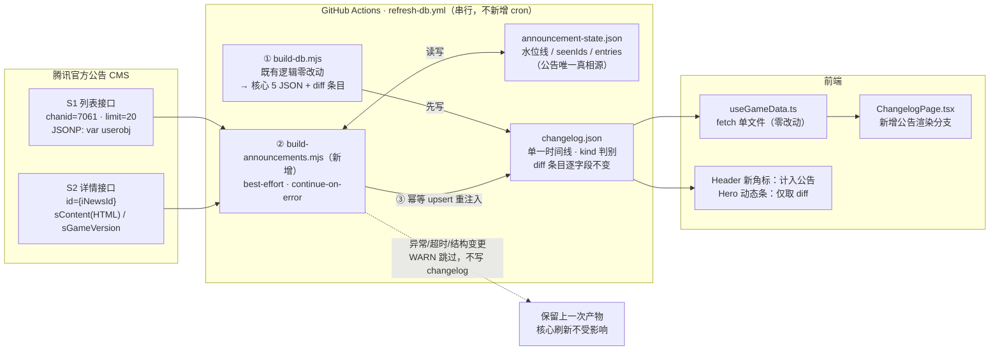
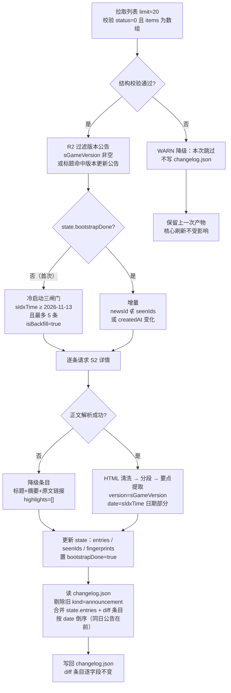

# 增量 PRD：接入官方版本更新公告，自动解析为版本日志

> 本文仅描述**本次变更部分**。既有能力（三步向导、图鉴、CDN 数据 diff 日志、每日自动刷新与部署）视为既定事实，不在需求范围内。

| 项 | 内容 |
| --- | --- |
| 文档版本 | v1.0（待架构评审） |
| 日期 | 2026-11-19 |
| 撰写 | 许清楚 · 产品经理 |
| 项目 | 王者万象棋小助手（静态站，GitHub Pages） |
| 项目名（snake_case） | `wzwxq_assistant_announcement_integration` |
| 技术栈 | 沿用既有：Vite + React + TS + Tailwind；数据构建为 Node.js 脚本 + GitHub Actions |
| 变更范围 | 新增 1 条抓取链路、1 个状态文件、1 类日志条目、1 个前端渲染分支；**不改动** `build-db.mjs` 的 diff 算法与既有产物结构 |
| 原始需求复述 | 官方发布 v1.11.1 更新公告（棋手嬴律「并购红利」触发条件调整、天赋「帝临」取消 4 级天赋商店投放、超级周 / 无双棋盘「锦绣星河」/ 星河织锦 / 万象速决等活动、BUG 修复与体验优化），但这类改动不在 CDN 结构化字段内，现有逐字段 diff 检测不到，版本日志停在 11-13。用户明确选择：**扩展抓取源，接入官方公告，自动解析成版本日志**。 |

---

## 0. 背景与问题定性

| 维度 | 现状 | 问题 |
| --- | --- | --- |
| 数据来源 | `game.gtimg.cn` 的 5 个 `589094_oscard_new_*.js` + `598252_oslineupbyrecommend_pro_*.js` | 只覆盖卡牌 / 棋手 / 阵容的**结构化字段** |
| 日志生成 | `build-db.mjs` 对 `name/desc/relationName/...` 做签名 diff | 天赋表无「投放等级」维度、无「并购红利」条目 → 公告类改动**不可观测** |
| 日志内容 | `changelog.json` 共 8 条（1 条基线 + 7 条 diff），最新 `2026-11-13` | 官方 11-19 已更新，站点无感知，用户反馈「又更新了」却看不到 |
| 根因 | **数据覆盖缺口**，不是 diff 逻辑缺陷 | 修复方向应为「补充新的数据源」，而非修改 diff 规则 |

**产品判断**：CDN diff 与官方公告描述的是两个不同层面——前者是「卡牌数值 / 描述字段变了」，后者是「规则、投放、活动、修复变了」。二者互补而非替代，因此本次采用**扩展而非替换**。

---

## 1. 本次变更范围与边界

| 类型 | 内容 |
| --- | --- |
| ✅ In Scope | ① 抓取官方公告列表 + 详情；② 判定「版本更新公告」并清洗 HTML、提取结构化要点；③ 生成公告型日志条目并与既有 diff 条目共存于同一时间线；④ 版本日志页新增公告卡片；⑤ 首页「新」角标正确响应公告；⑥ 冷启动防刷屏、幂等去重、失败降级、来源与版权标注 |
| ❌ Out of Scope | **不改动** `build-db.mjs` 中 `buildChangelog()` / `diffCategory()` 的任何逻辑；不改动 `database.json` `lineups.json` `chessPlayers.json` `meta.json` 的结构；不改动三步向导 / 图鉴 / 阵容推荐；不引入后端、数据库、LLM 或第三方服务；不改动现有 8 条 diff 条目的任何字段 |
| ⚠️ 允许的最小联动 | `src/types.ts` 类型扩展、`ChangelogPage.tsx` 新增分支、`Hero.tsx` / `App.tsx` 各 1 处过滤调整、`refresh-db.yml` 增加 1 个 step、`public/data/` 新增 1 个状态文件 |

---

## 2. 产品目标与用户价值

| # | 目标 | 用户价值 | 衡量指标 |
| --- | --- | --- | --- |
| G1 | **补齐不可观测的更新**：让规则 / 投放 / 活动 / 修复类改动在站点可见 | 玩家打开版本日志即可看懂「这次版本改了啥」，不再需要去官网翻公告 | 官方发布版本公告后 ≤ 1 个刷新周期内出现对应条目 |
| G2 | **单一时间线，来源可辨**：公告与卡牌数据改动同屏呈现，但清晰区分 | 玩家能区分「卡牌数据改动」（可量化、逐条）与「官方公告改动」（说明性、分段），不混淆两类信息 | 两类条目视觉可区分率 100%，每条公告均带来源与原文链接 |
| G3 | **零回归、零刷屏**：新增链路不影响既有数据刷新，也不淹没历史日志 | 站点稳定如常；老公告不倒灌、不误导（过期活动信息不再显眼） | 首次接入新增公告 ≤ 5 条；公告链路失败时核心产物 100% 不受影响 |

**三个目标正交**：G1 管「有没有」，G2 管「看得懂」，G3 管「别搞坏」。

---

## 3. 用户故事

| # | 用户故事 | 对应目标 |
| --- | --- | --- |
| US1 | As a 回归玩家，I want 在版本日志里直接读到 v1.11.1 改了什么（嬴律、帝临、活动、修复），so that 不用离开站点去官网翻公告就能决定这局怎么玩 | G1 |
| US2 | As a 数据向玩家，I want 一眼分清「官方公告说明」和「卡牌字段 diff」，so that 我不会把「帝临取消 4 级投放」误认为是天赋描述文本改了 | G2 |
| US3 | As a 玩家，I want 点击公告条目跳转到官方原文，so that 需要完整细节 / 活动规则时能核对权威信息 | G1 / G2 |
| US4 | As a 每日访问的用户，I want 首页「新」角标在官方发公告时亮起，so that 我能第一时间知道站点跟上了版本 | G1 |
| US5 | As a 站点使用者，I want 公告抓取出问题时站点照常可用、历史日志不被一次性灌满，so that 这次增强不会变成新的故障源 | G3 |

---

## 4. 既定事实：官方数据源（主理人已实测，直接作为实现依据）

| # | 用途 | 接口 | 返回 | 关键字段 |
| --- | --- | --- | --- | --- |
| S1 | 公告列表 | `https://apps.game.qq.com/cmc/cross?serviceId=389&withtop=yes&logic=or&typeids=1,2&sortby=sIdxTime&r1=userobj&start=0&limit=20&source=web_pc&filter=channel&exclusiveChannel=40&exclusiveChannelSign={sign}&time={ts}&chanid=7061` | JSONP `var userobj={...};`，`status=0`，`total=70` | `data.items[]`：`iNewsId`/`iId`、`sTitle`、`sDesc`、`sIdxTime`（如 `2026-11-18 19:08:04`）、`sCreated`、`sChannelInfoJson` |
| S2 | 公告详情 | `https://apps.game.qq.com/wmp/v3.1/public/searchNews.php?p0=389&source=web_pc&id={iNewsId}` | JSONP `var searchObj={...};` | `msg`：`sTitle`、`sDesc`、`sContent`（HTML 正文，约 3400 字）、`sGameVersion`（如 `v1.11.1`）、`sIdxTime`、`sCreated` |
| S3 | 用户可见原文 | `https://wxq.qq.com/cp/appointment/newsdetail.html?newsid={id}&tab=3`（列表页 `newslist.html`） | HTML 页面 | 用作卡片「查看官方原文」外链 |

**签名与栏目约定**

| 项 | 值 |
| --- | --- |
| `sign` | `md5('9784d353d1f9ca34a59b61752630dade' + 'web_pc' + '389' + ts)` |
| `ts` | 秒级 Unix 时间戳**字符串** |
| `chanid` | `7061` = 公告（7059 全部 / 7060 新闻 / 7062 活动 / 7063 栏目） |
| 实测首条 | 「11月19日版本更新公告v1.11.1」，`iNewsId = 18956191` |
| 正文结构 | `【更新时间】【更新范围】【更新方式】` 元信息 + 分段改动说明，标签以 `<p>/<br>/<span>/<strong>` 为主 |

> **实现提示**：现有 `build-db.mjs` 的 `extractJSON()` 已兼容 `var x = {...};` 包裹、`fetchJSON()` 已带超时重试、`cleanDesc()` 已具备 HTML 清洗基础，公告脚本可复用同一套工具思路（不要求改动原脚本）。

---

## 5. 方案决策：两类日志如何共存

### 5.1 候选对比

| 维度 | **A. 合并进同一 `changelog.json`（推荐）** | B. 独立 `announcements.json` + 前端分区 |
| --- | --- | --- |
| 用户心智 | 一条时间线，符合「这次版本改了啥」的直觉 | 两个信息孤岛，同日改动被拆到两处 |
| 同日既有 diff + 公告 | 天然聚合为一个日期分组 | 前端需再做一次跨文件合并排序 |
| 前端改动 | `useGameData.ts` **零改动**（仍只 fetch 一个文件）；仅 `types.ts` 扩展 + `ChangelogPage.tsx` 加分支 | 需改 `useGameData.ts` 数据汇集、`GameData` 类型、新增一条 fetch 失败路径与兜底 |
| 产物契约 | 不变；`git add -A public/data/` 与部署链路零改动 | 新增一条产物，需新增校验与兜底 |
| 与既有机制顺承 | 复用现有「同日合并」「按 date 倒序」「上限裁剪」的语义 | 需自建一套并行机制 |
| 主要代价 | 需保证写入幂等，避免公告条目被 `slice(0,60)` 挤出（见 §9 R8，风险极低且有对策） | 前端复杂度更高、双份状态 |

**结论：采用方案 A。** 核心理由：用户要的是「一条看得懂的版本时间线」，而前端当前已是「单数组 + 按 date 倒序」的极简结构，方案 A 的改动面最小、用户价值最高。两类条目通过新增判别字段 `kind` 区分，**现有 diff 条目不新增任何字段**（无 `kind` 即视为 `diff`，向后兼容），从而严格满足「不改动既有 diff 日志机制」的边界。

### 5.2 推荐架构与数据流



**三条设计要点**

1. **物理隔离**：公告抓取放在**独立脚本** `scripts/build-announcements.mjs`，由 workflow 在 `build-db.mjs` 之后以 `continue-on-error: true` 调用。公告脚本崩溃 / 超时 / 接口变更，都不会让 `node scripts/build-db.mjs` 失败，也不会触发其 `ABORT` 护栏。
2. **状态为真相源**：`announcement-state.json` 保存已解析的公告条目全量。每次运行先读 `changelog.json` → **剔除所有 `kind='announcement'` 的残留** → 从 state 重新注入 → 按 `date` 倒序写回。该操作幂等，因此既解决去重，也解决「被 `slice(0,60)` 挤出」的问题。
3. **失败不改写**：公告链路失败时**完全不写** `changelog.json`，保留 `build-db.mjs` 刚写好的 diff 结果。

---

## 6. 需求池（P0 必须 / P1 应当 / P2 可选）

| ID | 优先级 | 需求 | 说明与边界 | 可验证结果 |
| --- | --- | --- | --- | --- |
| R1 | **P0** | 新增公告列表抓取 | S1 接口；`sign`/`ts` 按 §4 生成；`limit=20`；校验 `status===0` 且 `data.items` 为数组 | 返回 20 条内公告元数据 |
| R2 | **P0** | 过滤「版本更新公告」 | 仅当 `sGameVersion` 非空 **或** 标题命中 `/版本更新公告\|更新公告\|版本更新/`。活动 / 新闻类一律不导入 | 70 条历史中仅版本公告进入候选，活动新闻被过滤 |
| R3 | **P0** | 新增公告详情抓取与 HTML 清洗 | S2 接口；按 `<p>/<br>` 切段、去标签、去 `【…】` 元信息、合并空白；保留分段语义 | 输出分段纯文本，不产生乱码 / 标签残留 |
| R4 | **P0** | 规则式要点提取（不引入 LLM） | 以 `【…】`/`一、二、三`/`1.` 识别分段标题；按关键词粗分类打 tag；生成 `highlights[]` | v1.11.1 提取 ≥ 4 条要点，覆盖 ≥ 4 类分段 |
| R5 | **P0** | 生成 `AnnouncementEntry` 并合并写入 `changelog.json` | 按 `kind` 判别；幂等 upsert；同日「公告在前、diff 在后」；**不修改任何既有 diff 条目字段** | 现有 8 条 diff 条目 JSON 逐字段一致 |
| R6 | **P0** | 冷启动防刷屏 | 见 §9 R1：水位线 + 条数上限 + `isBackfill` 标记 | 首次接入新增公告 ≤ 5 条 |
| R7 | **P0** | 幂等去重 | `newsId` 为主键，`title+sIdxTime` 为兜底指纹；`sCreated` 变化视为公告编辑并更新要点 | 连续运行 3 次条目数不增长 |
| R8 | **P0** | 失败降级与隔离 | 任一环节异常 → `[WARN]` 跳过、不写 `changelog.json`；核心 5 个 JSON 与构建退出码不受影响 | 模拟 500 / 非 JSONP / 结构变更，主流程退出码 0 |
| R9 | **P0** | 来源标注与版权声明 | 每条公告卡片显示来源、发布时间、原文链接与版权文案；不存储 `sContent` 全文 | 页面可见标注，产物中无公告全文 |
| R10 | **P0** | 版本日志页渲染公告卡片 | `kind==='announcement'` 走新分支；`kind!=='announcement'` 的现有渲染代码**零改动** | 两类条目同屏且可区分 |
| R11 | **P0** | 首页联动修正 | `Header` 的「新」角标**计入公告**；`Hero` 的「最近更新」数字条**仅取 diff** | 公告发布后角标亮起，动态条不消失 / 不显示 0 |
| R12 | P1 | 公告卡片「查看官方原文」外链 | S3 链接，`target="_blank"` + `rel="noopener noreferrer"` | 链接可 200 打开 |
| R13 | P1 | 要点按分段分组折叠展示 | 长公告默认展开前 2 个分段，「展开全部」可看完整要点 | 单卡片不撑破 `max-h-[88vh]` 容器 |
| R14 | P1 | 解析降级条目 | 正文结构异常时仍生成「标题 + 摘要 + 原文链接」，`highlights=[]` + `parseWarning` | 前端不报错、不显示空卡片 |
| R15 | P1 | 类型 / 筛选筛选器（按来源） | 日志页顶部加「全部 / 官方公告 / 数据改动」切换 | 切换后条目数正确 |
| R16 | P2 | 列表翻页兜底 | 单日新增 > 20 条时按 `start` 翻页 | 不漏公告 |
| R17 | P2 | 公告条目数上限与按 kind 分组裁剪 | 公告保留最近 N 条；将来 diff 接近 60 条时再评估改 `slice` 语义（本次不改） | 长期运行产物不膨胀 |
| R18 | P2 | 抓取健康度记录 | `state` 中 `lastSuccessAt` / `parseWarnings`，便于排查接口变更 | 可追溯最近一次成功 |

---

## 7. 数据模型

### 7.1 `changelog.json` 顶层契约（可辨识联合）

| 规则 | 说明 |
| --- | --- |
| 顶层 | 数组，按 `date` 倒序 |
| diff 条目 | **保持现状结构不变**（`version/date/title/baseline?/summary?/changes[]`），**不新增 `kind` 字段**；无 `kind` 即视为 diff |
| 公告条目 | 必带 `kind: 'announcement'`，字段见 §7.2 |
| 同日排序 | `date` 相同时，公告条目在前、diff 条目在后；同类型内按 `publishedAt` / 原顺序 |
| 同日合并 | **不做字段级合并**（不复用 `buildChangelog` 的 `changes` 拼接逻辑）：两类条目物理并存，由 UI 按日期分组呈现。理由：`changes[]` 的 `cat/type/name/id` 语义只属于 diff，强行合并会污染数据模型 |

### 7.2 `AnnouncementEntry` JSON Schema（draft-07）

```json
{
  "$schema": "http://json-schema.org/draft-07/schema#",
  "$id": "https://sleepycat1010.github.io/wzwxq-assistant/schemas/announcement-entry.json",
  "title": "AnnouncementEntry",
  "description": "官方版本更新公告条目，与 CDN diff 条目共存于 public/data/changelog.json 同一时间线",
  "type": "object",
  "additionalProperties": false,
  "required": ["kind", "version", "date", "title", "newsId", "summary", "highlights", "sourceUrl", "source", "publishedAt", "fetchedAt"],
  "properties": {
    "kind": { "const": "announcement", "description": "判别字段；现有 diff 条目不带此字段" },
    "version": {
      "type": "string", "minLength": 1,
      "description": "官方版本号，取 sGameVersion；提取失败回退为 date（YYYY-MM-DD）",
      "examples": ["v1.11.1"]
    },
    "date": {
      "type": "string", "format": "date",
      "description": "排序用日期，取 publishedAt 的 YYYY-MM-DD 部分（注意：可能与标题中的『11月19日』不同）",
      "examples": ["2026-11-18"]
    },
    "title": { "type": "string", "minLength": 1, "description": "官方标题原文，不改写、不截断", "examples": ["11月19日版本更新公告v1.11.1"] },
    "newsId": { "type": "string", "minLength": 1, "description": "官方 iNewsId，去重主键", "examples": ["18956191"] },
    "summary": { "type": "string", "maxLength": 120, "description": "一句话摘要：sDesc 清洗后；为空时取 highlights[0].text 截断" },
    "highlights": {
      "type": "array",
      "description": "结构化要点；解析失败允许为空数组，前端降级为『标题 + 摘要 + 原文链接』",
      "items": { "$ref": "#/definitions/highlight" }
    },
    "sourceUrl": { "type": "string", "format": "uri", "description": "S3 官方资讯中心详情页，用户可点击", "examples": ["https://wxq.qq.com/cp/appointment/newsdetail.html?newsid=18956191&tab=3"] },
    "source": { "$ref": "#/definitions/source" },
    "publishedAt": { "type": "string", "description": "官方 sIdxTime 原值", "examples": ["2026-11-18 19:08:04"] },
    "createdAt": { "type": "string", "description": "官方 sCreated；变化表示公告被编辑重发，需刷新要点" },
    "fetchedAt": { "type": "string", "format": "date-time", "description": "本站抓取时间 ISO 8601" },
    "tags": { "type": "array", "uniqueItems": true, "items": { "enum": ["棋手", "天赋", "活动", "修复", "优化", "其他"] } },
    "isBackfill": { "type": "boolean", "default": false, "description": "冷启动补录标记，前端可弱化展示" },
    "parseWarning": { "type": "string", "description": "正文解析异常时的降级说明；正常时省略" }
  },
  "definitions": {
    "highlight": {
      "type": "object",
      "additionalProperties": false,
      "required": ["section", "text", "order"],
      "properties": {
        "section": { "type": "string", "description": "分段标题", "examples": ["棋手调整", "天赋调整", "活动", "BUG修复", "体验优化"] },
        "tag": { "enum": ["棋手", "天赋", "活动", "修复", "优化", "其他"] },
        "text": { "type": "string", "minLength": 1, "maxLength": 200, "description": "清洗后的单条要点纯文本" },
        "order": { "type": "integer", "minimum": 0 }
      }
    },
    "source": {
      "type": "object",
      "additionalProperties": false,
      "required": ["name", "copyright"],
      "properties": {
        "name": { "const": "腾讯《王者万象棋》官方公告" },
        "channelId": { "type": "string", "examples": ["7061"] },
        "listApi": { "type": "string", "format": "uri" },
        "detailApi": { "type": "string", "format": "uri" },
        "copyright": { "const": "内容版权归腾讯所有，本站仅作信息聚合，详情请以官方原文为准" }
      }
    }
  }
}
```

### 7.3 `announcement-state.json` Schema（新增，`public/data/` 下随 workflow 自动提交）

```json
{
  "$schema": "http://json-schema.org/draft-07/schema#",
  "title": "AnnouncementState",
  "description": "公告抓取状态：水位线（防刷屏）+ 去重集合 + 已解析条目（唯一真相源）。仅含 id/时间戳/结构化要点，无敏感信息，可公开。",
  "type": "object",
  "additionalProperties": false,
  "required": ["bootstrapDone", "bootstrapSince", "bootstrapLimit", "seenIds", "entries", "lastFetchedAt"],
  "properties": {
    "bootstrapDone": { "type": "boolean", "description": "是否已完成首次接入" },
    "bootstrapSince": { "type": "string", "format": "date", "description": "冷启动水位线，默认取现有 changelog 最新 diff 日期 2026-11-13", "examples": ["2026-11-13"] },
    "bootstrapLimit": { "type": "integer", "minimum": 1, "default": 5 },
    "seenIds": { "type": "array", "items": { "type": "string" }, "description": "已处理 iNewsId，去重主键" },
    "fingerprints": { "type": "array", "items": { "type": "string" }, "description": "title + sIdxTime 兜底指纹，防官方改 id 重发" },
    "entries": { "type": "array", "items": { "$ref": "announcement-entry.json" }, "description": "已解析公告条目全量；每次运行幂等重注入 changelog.json" },
    "lastFetchedAt": { "type": "string", "format": "date-time" },
    "lastSuccessAt": { "type": "string", "format": "date-time" },
    "parseWarnings": { "type": "array", "items": { "type": "string" } }
  }
}
```

### 7.4 v1.11.1 目标条目示例（期望产出）

```json
{
  "kind": "announcement",
  "version": "v1.11.1",
  "date": "2026-11-18",
  "title": "11月19日版本更新公告v1.11.1",
  "newsId": "18956191",
  "summary": "棋手嬴律与天赋帝临调整，超级周等系列活动开启，并修复一批问题与体验优化。",
  "highlights": [
    { "section": "棋手调整", "tag": "棋手", "text": "嬴律「并购红利」触发条件调整。", "order": 0 },
    { "section": "天赋调整", "tag": "天赋", "text": "「帝临」取消 4 级天赋商店投放。", "order": 1 },
    { "section": "活动", "tag": "活动", "text": "超级周、无双棋盘「锦绣星河」、星河织锦、万象速决等活动开启。", "order": 2 },
    { "section": "问题修复", "tag": "修复", "text": "修复一批已知 BUG。", "order": 3 },
    { "section": "体验优化", "tag": "优化", "text": "多项交互与体验优化。", "order": 4 }
  ],
  "sourceUrl": "https://wxq.qq.com/cp/appointment/newsdetail.html?newsid=18956191&tab=3",
  "source": {
    "name": "腾讯《王者万象棋》官方公告",
    "channelId": "7061",
    "copyright": "内容版权归腾讯所有，本站仅作信息聚合，详情请以官方原文为准"
  },
  "publishedAt": "2026-11-18 19:08:04",
  "fetchedAt": "2026-11-19T12:31:54.014Z",
  "tags": ["棋手", "天赋", "活动", "修复", "优化"],
  "isBackfill": true
}
```

> 字段设计说明：`version` 在 diff 条目中是日期、在公告条目中是官方版本号，二者语义不同但类型同为 `string`；采用可辨识联合后，前端按 `kind` 分别渲染，不会互相污染。

---

## 8. UI 展示设计（版本日志页）

### 8.1 布局与视觉区分

| 元素 | 公告型条目 | 既有 diff 条目（保持不变） |
| --- | --- | --- |
| 来源徽标 | 左上角 `官方公告` 徽标（gold 描边）+ `版本 v1.11.1` 药丸标签 | `版本 2026-11-13` 药丸标签 |
| 标题 | 官方标题原文，字号略大、可换行 | `官方数据更新` |
| 日期 | 显示 `2026-11-18`（排序用），旁附小字「发布于 11-18 19:08」，标题中的「11月19日」保留原文不改写 | `2026-11-13` |
| 主体 | 按 `section` 分组的要点列表：分段小标题 + 圆点列表；每条要点可带 `tag` 小标签 | `新增/移除/改动` 汇总数字 + `逐条 cat/name` 列表 |
| 摘要 | 标题下 1 行灰色摘要（`summary`） | 无 |
| 底部 | 「查看官方原文 ↗」外链 + 版权小字 | 无 |
| 卡片底色 | 与 diff 卡片一致，仅以左侧竖线 / 徽标色区分，避免视觉噪音 | 现状 |

### 8.2 卡片线框

```
┌─ 版本更新日志 ──────────────────────────────── 关闭 ┐
│ 由定时抓取自动对比官方数据 + 同步官方公告生成        │
│                                                      │
│ ┌ 2026-11-18 ─────────────────────────────────────┐ │
│ │ [官方公告]  11月19日版本更新公告v1.11.1           │ │
│ │              [版本 v1.11.1]  发布于 11-18 19:08   │ │
│ │ 棋手嬴律与天赋帝临调整，超级周等系列活动开启…      │ │
│ │ ─────────────────────────────────────────────── │ │
│ │ ▍棋手调整                                        │ │
│ │   • 嬴律「并购红利」触发条件调整。     [棋手]      │ │
│ │ ▍天赋调整                                        │ │
│ │   • 「帝临」取消 4 级天赋商店投放。    [天赋]      │ │
│ │ ▍活动 / 问题修复 / 体验优化        [展开全部 ▾]   │ │
│ │ ─────────────────────────────────────────────── │ │
│ │ 查看官方原文 ↗   内容版权归腾讯所有，仅作信息聚合  │ │
│ └──────────────────────────────────────────────────┘ │
│ ┌ 2026-11-13 ─────────────────────────────────────┐ │
│ │ 官方数据更新  [版本 2026-11-13]                   │ │
│ │ [新增 1] [改动 3]                                 │ │
│ │ [改动][天赋] 帝临 …                               │ │
│ └──────────────────────────────────────────────────┘ │
└──────────────────────────────────────────────────────┘
```

### 8.3 交互与联动规则

| 规则 | 说明 |
| --- | --- |
| 同日分组 | 同一 `date` 的公告与 diff 条目归入同一日期分组；组内公告在上、diff 在下。**不做对象合并** |
| 跳转 | 「查看官方原文」→ S3 详情页，新标签打开，带 `noopener noreferrer` |
| 长内容 | 默认展示前 2 个 `section`，其余折叠（P1）；容器沿用 `max-h-[88vh]` 内部滚动 |
| 空要点 | `highlights=[]` 时仅显示标题 + 摘要 + 原文链接，不渲染空列表 |
| **首页「新」角标** | `App.tsx` 的 `hasNewUpdate` **计入公告**（30 天内最新条目）——这正是本次用户诉求「站点要体现更新」 |
| **首页「最近更新」动态条** | `Hero.tsx` 的 `sorted` 需**过滤掉 `kind==='announcement'`**，只取 diff 条目计算 added/changed/removed 数字；否则 `latestUpdate()` 因公告无 `changes` 字段返回 `null`，动态条会消失 |
| 顶部说明文案 | 由「由定时抓取自动对比官方数据生成，记录英雄 / 棋手 / 装备的改动」更新为同时提及官方公告同步 |

---

## 9. 关键边界与风险

| ID | 风险 / 边界 | 等级 | 策略 | 降级结果 |
| --- | --- | --- | --- | --- |
| R1 | **首次接入 70 条历史公告一次性刷屏**（重点） | 高 | 三重闸门：① **类型闸门**（R2 仅导入版本更新公告，天然滤掉大量活动 / 新闻）；② **水位线**：`bootstrapSince` 默认取现有 changelog 最新 diff 日期 `2026-11-13`，首次只导入 `sIdxTime ≥ 2026-11-13` 的公告；③ **条数上限**：`bootstrapLimit` 默认 5。导入条目标 `isBackfill=true`。首次跑完置 `bootstrapDone=true`，之后仅走增量 | 首次新增 ≤ 5 条，现有 8 条 diff 日志不被淹没；过期活动公告不倒灌 |
| R2 | 同一公告多次抓取 / 官方改 id 重发 | 高 | `newsId` 主键 + `title+sIdxTime` 兜底指纹双去重；`sCreated` 变化视为编辑，更新 `highlights` 而非新增条目；state 中 `entries` 幂等重注入 | 连续运行不产生重复条目 |
| R3 | 同一天既有 CDN diff 又有公告 | 中 | 物理并存两条 `kind` 不同的条目，UI 按日期分组；**不复用** `buildChangelog` 的 `changes` 拼接（该逻辑只适用于 diff 语义） | 两类信息都可见、互不污染 |
| R4 | 抓取失败 / 接口变更导致数据库刷新失败 | **高** | 独立脚本 + `continue-on-error: true`；全流程 `try/catch`；`status!==0`、`items` 非数组、`msg` 缺失、`sContent` 为空一律视为失败；失败时**不写** `changelog.json`；`fetch` 带超时与重试 | 核心 5 个 JSON 与 diff 日志字节不变，构建退出码 0，站点照常部署 |
| R5 | 官方接口签名 / 栏目 / JSONP 变量名变更 | 中 | 校验 `var userobj` / `var searchObj` 包裹与关键字段；解析异常记 `parseWarnings`，不影响主流程；保留 `lastSuccessAt` 便于发现「长期无新公告」 | 静默跳过公告同步，diff 日志继续正常更新 |
| R6 | HTML 正文清洗与要点提取可行性 | 中 | 采用**规则式**提取（可复现、零成本、无密钥），不引入 LLM：`<p>/<br>` 切段 → 去标签 → 识别 `【…】`/`一、二、三`/`1.` 分段标题 → 关键词打 tag → 截断 200 字。`【更新时间】【更新范围】【更新方式】` 归为元信息不进要点。官方版式变化时提取退化 | 降级为「标题 + 摘要 + 原文链接」，`highlights=[]` + `parseWarning`；前端不报错 |
| R7 | 法律与来源标注 | 高 | **不存储 / 不展示 `sContent` 全文**，仅保留结构化要点（摘要性、转换性使用）+ 原文链接；每条卡片显示来源名、发布时间与版权文案；与现有 `meta.json` 的「所有内容版权归腾讯及原作者所有」口径一致 | 无全文转载风险；用户可一键核对权威原文 |
| R8 | 公告条目被 `build-db.mjs` 的 `slice(0,60)` 挤出 | 低 | 公告 date 最新，恒在数组头部；且公告脚本每次从 state **幂等重注入**，即使被裁也会恢复。当前 diff 仅 8 条，余量充足。若将来 diff 接近 60 条，再评估「按 kind 分组裁剪」（P17，本次**不改** `slice` 语义） | 公告条目不丢失 |
| R9 | 首页 / 顶栏联动被破坏 | 中 | 按 §8.3 修正 `Hero.tsx`（过滤公告）与 `App.tsx`（计入公告） | 角标正确亮起、动态条不消失 |
| R10 | 时间语义错位 | 低 | 公告标题写「11月19日」，但 `sIdxTime` 为 `2026-11-18 19:08:04`。**`date` 以 `sIdxTime` 为准**用于排序，`title` 保留官方原文，卡片附「发布于」小字消除歧义 | 时间线不错位、不误导 |
| R11 | 新增状态文件被公开部署 | 低 | `announcement-state.json` 仅含 id / 时间戳 / 结构化要点，无敏感信息；置于 `public/data/` 以复用现有 `git add -A public/data/` 持久化 | 无隐私 / 合规问题 |

### 9.1 冷启动与增量决策流程



---

## 10. 验收标准（可量化）

| # | 场景 | 判定标准 |
| --- | --- | --- |
| AC1 | 首次接入后产物 | `changelog.json` 中 `kind='announcement'` 条目 **≤ 5** 条；现有 **8 条** diff 条目与基线做 JSON 逐字段比对 **完全一致**（含 `summary` / `changes` 顺序） |
| AC2 | v1.11.1 条目完整性 | 刷新后 ≤ 1 个定时周期内出现 `newsId='18956191'`；`version='v1.11.1'`；`title` 含「11月19日版本更新公告」；`highlights ≥ 4` 条且 `section` 覆盖「棋手 / 天赋 / 活动 / 修复 / 优化」中 **≥ 4** 类；`sourceUrl` 返回 200 |
| AC3 | 去重幂等 | 连续执行 3 次（模拟 3 天刷新，公告无变化），公告条目数 **不增长**，`seenIds` 长度稳定，`changelog.json` 第 2/3 次运行后 git diff 为空 |
| AC4 | 同日并存 | 构造同一 `date` 下 1 条公告 + 1 条 diff，页面同一日期分组内**两者均可见**，且分别显示「官方公告」徽标与「新增/改动」汇总 |
| AC5 | 降级隔离 | 分别模拟 S1 返回 500、返回非 JSONP 文本、`data.items` 缺失、S2 `sContent` 为空：`build-db.mjs` 退出码 **0**；`database.json` / `lineups.json` / `chessPlayers.json` / `meta.json` 与 diff 日志字节不变；`npm run build` 通过且 Pages 部署成功 |
| AC6 | 解析降级 | 构造结构异常的 `sContent`，仍生成有效条目（`highlights=[]` + `parseWarning`），前端不出现空卡片 / 控制台报错 |
| AC7 | 前端联动 | 存在 30 天内公告时顶栏「新」角标**亮起**；首页「最近更新」动态条显示的 added/changed/removed 数字与最新 **diff** 条目一致，不为 0、不消失 |
| AC8 | 版权与外链 | 100% 公告卡片可见来源名、发布时间、版权文案与可点击原文链接；产物中**不含** `sContent` 全文（全文字符串不出现在 `public/data/*.json`） |
| AC9 | 类型与构建 | `npm run build` 无 TS 报错；`ChangelogEntry` 联合类型覆盖两种分支；`useGameData.ts` 保持零改动 |
| AC10 | 视觉区分 | 两类条目的徽标 / 主体结构在 375px 与 1280px 宽度下均不重叠、不溢出，长公告折叠后卡片高度 ≤ 容器可视区 |

---

## 11. 待确认问题（含主理人可代为决策的默认建议）

| # | 问题 | **默认建议（可直接采纳）** | 备选 |
| --- | --- | --- | --- |
| Q1 | 冷启动导入多少条历史公告？ | **仅导入 `sIdxTime ≥ 2026-11-13` 的版本公告，且上限 5 条**（预计 1~3 条），`isBackfill=true`。理由：用户痛点是「这次更新没体现」，不是补齐历史档案；且现有 8 条 diff 跨 10-11~11-13，时间跨度相称 | ① 仅 1 条（v1.11.1，最保守）；② 最近 3 条；③ 全量 70 条但默认折叠（不推荐，维护成本高） |
| Q2 | 公告抓取频率？ | **复用现有每日 03:17 CST 的 `refresh-db.yml` 串行追加一个 step，不新增 cron**。理由：版本公告低频，零新增基础设施 | 每 6 小时独立 cron（P2，仅当发现公告时效性强时再评估） |
| Q3 | 是否展示活动 / 新闻类公告？ | **不展示**。R2 类型闸门只放行版本更新公告。理由：活动类信息过期快、数量大，是刷屏主因 | 后续单独做「活动日历」页（不在本次范围） |
| Q4 | 要点提取是否引入 LLM？ | **不引入**，规则式提取。理由：静态站 + GitHub Actions 无密钥、需可复现、零成本；当前官方版式规整，规则式足够 | 若官方版式碎片化严重，再评估离线规则增强（P2） |
| Q5 | 是否保存公告全文？ | **不保存**，仅结构化要点 + 原文链接。理由：版权与产物体积双重考虑 | 保存脱敏全文快照用于 diff（不推荐） |
| Q6 | `date` 取「标题里的 11月19日」还是 `sIdxTime` 的 11-18？ | **取 `sIdxTime` 的日期（`2026-11-18`）用于排序与分组**；标题原文不改，卡片加「发布于」小字。理由：时间线必须以客观发布时间为准 | 取标题日期（会导致排序与官方发布时间不一致，不推荐） |
| Q7 | `sGameVersion` 缺失时 `version` 填什么？ | **回退为 `date`（`YYYY-MM-DD`）**，并在 `state.parseWarnings` 记录；前端仍可正常渲染 | 填「未知版本」（会破坏排序与展示一致性） |
| Q8 | 状态文件位置与命名？ | **`public/data/announcement-state.json`**，随现有 `git add -A public/data/` 自动提交。理由：必须持久化才能实现水位线与去重，且该目录已被工作流覆盖 | `scripts/.state/`（不推荐：不会被自动提交，Actions 每次都是干净环境） |
| Q9 | 是否加来源筛选 tab？ | **P1 再做**，本次先以「单一时间线 + 徽标视觉区分」交付。理由：先验证公告链路价值，避免在数据量小的时候增加交互复杂度 | 本次即做（需额外前端工时） |
| Q10 | 公告脚本放独立文件还是并入 `build-db.mjs`？ | **独立 `scripts/build-announcements.mjs` + `continue-on-error: true`**。理由：物理隔离最彻底，满足「不能让现有数据库刷新失败」的硬约束，且 `build-db.mjs` 保持零改动 | 并入同脚本 try/catch（隔离性弱，且违反「不改动既有机制」） |
| Q11 | 是否需要处理 `limit=20` 不够？ | **本次不处理**（配水位线后单日新增极少），列 P2 翻页兜底 | 本次即做翻页 |
| Q12 | 首页「新」角标是否计入公告？ | **计入**（这是用户诉求的核心感知点）；但「最近更新」数字条**仅取 diff**。理由：数字语义只属于 diff，角标语义属于「有无更新」 | 角标也只取 diff（会导致公告发布后站点仍无提示，不推荐） |

---

## 12. 给架构师的交接要点（代码级影响面清单）

| 文件 | 改动性质 | 要点 |
| --- | --- | --- |
| `scripts/build-db.mjs` | **零改动** | 不得修改 `buildChangelog()` / `diffCategory()` / 同日 `changes` 合并 / `slice(0,60)` / `ABORT` 护栏 |
| `scripts/build-announcements.mjs` | 新增 | 复用 `extractJSON` / `fetchJSON`(超时重试) / `cleanDesc` 的**思路**；独立 `try/catch`；失败不写文件 |
| `.github/workflows/refresh-db.yml` | 增量 | 在「抓取并生成基础数据库」后加 1 step，`continue-on-error: true`；提交步骤的 `git add -A public/data/` 已覆盖新状态文件，无需改 |
| `public/data/changelog.json` | 数据变更 | 合并公告条目；diff 条目逐字段不变 |
| `public/data/announcement-state.json` | 新增 | 见 §7.3 |
| `src/types.ts` | 类型扩展 | `ChangelogEntry` → `DiffChangelogEntry \| AnnouncementChangelogEntry` 可辨识联合；现有字段保持，新增 `kind` 为判别键；`GameData.changelog` 类型随之更新 |
| `src/components/ChangelogPage.tsx` | 新增分支 | `Entry` 顶部先按 `kind` 分流：`kind==='announcement'` 走新组件，其余**沿用现有代码不动**；顶部说明文案更新；按日期分组（同日公告在前） |
| `src/components/Hero.tsx` | 1 处过滤 | `sorted` 增加排除 `kind==='announcement'`，避免 `latestUpdate()` 返回 `null` 导致动态条消失 |
| `src/App.tsx` | 1 处调整 | `hasNewUpdate` 的 `list` **包含**公告条目，使「新」角标正确响应 |
| `src/hooks/useGameData.ts` | **零改动** | 仍只 fetch `changelog.json`；这是选择方案 A 的直接收益 |
| `src/data/fallback.ts` | 按需 | 若内联兜底含 changelog，需保证联合类型兼容；无 changelog 则不动 |

**一句话总结**：新增一条「官方公告 → 结构化要点」的旁路数据链路，以 `kind` 判别字段并入既有 `changelog.json` 单一时间线；`build-db.mjs` 与其 diff 机制零改动，公告链路完全 best-effort，首次接入用水位线 + 类型闸门 + 条数上限三重防刷屏。
